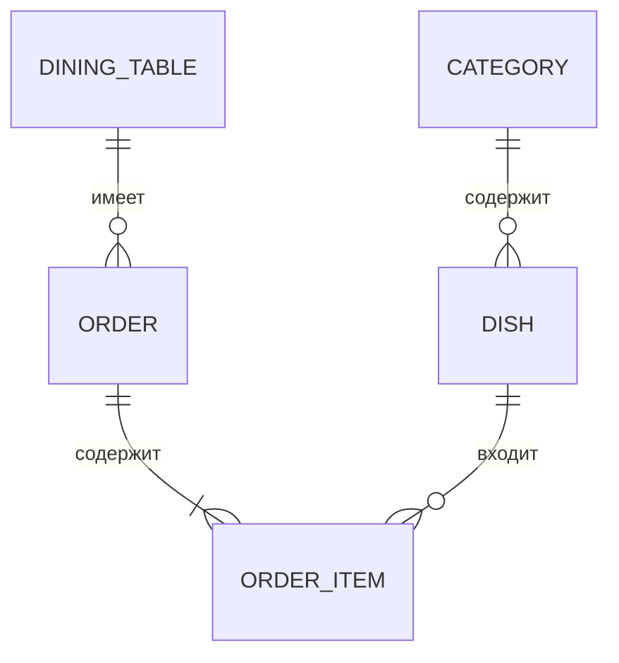

# Практическое занятие № 5–6
## Вариант № 8 — «Ресторан»

### 1. Описание сущностей и связей

| Сущность | Поля | Назначение |
|---|---|---|
| Категория блюда (`Category`) | название | Хранит категории: закуски, горячее, напитки |
| Блюдо (`Dish`) | название, цена, вес, описание, категория | Хранит блюда меню |
| Столик (`DiningTable`) | номер, количество мест, статус | Хранит столики ресторана |
| Заказ (`Order`) | столик, дата, статус, сумма | Хранит заказ посетителя |
| Позиция заказа (`OrderItem`) | заказ, блюдо, количество | Хранит блюдо и его количество в заказе |

ER-диаграмма:



### 2. Типы связей

| Связь | Тип | Реализация в Django |
|---|---|---|
| Категория — Блюдо | 1:N | `ForeignKey` в `Dish` |
| Столик — Заказ | 1:N | `ForeignKey` в `Order` |
| Заказ — Позиция заказа | 1:N | `ForeignKey` в `OrderItem` |
| Блюдо — Заказ | M:N через позицию заказа | `OrderItem` как связующая модель |

### 3. Структура проекта

```text
restaurant_variant8/
├── manage.py
├── requirements.txt
├── README_Запуск.txt
├── restaurant_project/
│   ├── settings.py
│   ├── urls.py
│   ├── asgi.py
│   └── wsgi.py
├── core/
│   ├── views.py
│   ├── urls.py
│   └── templates/core/home.html
└── restaurant/
    ├── models.py
    ├── views.py
    ├── urls.py
    ├── admin.py
    └── templates/restaurant/
        ├── menu.html
        ├── dish_detail.html
        ├── order_form.html
        └── order_success.html
```

### 4. Реализация модулей

Проект называется `restaurant_project`. Приложение `core` отвечает за главную страницу, а приложение `restaurant` — за меню, категории, столики, заказы и позиции заказа.

В `models.py` созданы пять моделей. Для связи категории с блюдом используется `ForeignKey`. Столик связан с заказами отношением 1:N. Позиция заказа соединяет заказ и блюдо, поэтому блюда и заказы связаны отношением M:N через отдельную таблицу.

В `views.py` находятся три представления: главная страница, список блюд с фильтрацией и карточка блюда, а также создание заказа методом POST. В `admin.py` зарегистрированы все модели для добавления тестовых данных через административную панель.

### 5. Маршрутизация

| URL | Описание | Метод |
|---|---|---|
| `/` | Главная страница | GET |
| `/menu/` | Список блюд | GET |
| `/menu/<int:pk>/` | Детали блюда | GET |
| `/menu/?category=...` | Фильтр блюд по категории | GET |
| `/orders/create/` | Оформление заказа | GET для показа формы, POST для сохранения |

### 6. Реализация представлений

На главной странице выводится приветствие и ссылки на меню и оформление заказа. Страница меню выводит блюда из базы данных. Если передан параметр `category`, список фильтруется по выбранной категории. Страница блюда показывает название, категорию, цену, вес и описание.

При отправке формы заказа методом POST программа получает столик, блюдо и количество. Затем создаёт заказ и позицию заказа, вычисляет сумму и меняет статус столика на «Занят».

### 7. Админ-панель

Модели `Category`, `Dish`, `DiningTable`, `Order` и `OrderItem` зарегистрированы в `admin.py`. Чтобы открыть админку, создайте суперпользователя командой `python manage.py createsuperuser`, запустите сервер и перейдите по адресу `/admin/`.

### 8. Фильтрация (GET)

Фильтрация сделана на странице `/menu/`. Параметр `category` передаётся в URL методом GET. Пример: `/menu/?category=1`. Число `1` — идентификатор категории в базе данных.

### 9. Формы (POST)

Форма находится на странице `/orders/create/`. Она отправляет столик, блюдо и количество методом POST. В шаблоне используется ``. После отправки программа сохраняет заказ и показывает его номер, сумму и статус.

### Инструкция по запуску

Подробная пошаговая инструкция находится в файле `README_Запуск.txt`.
